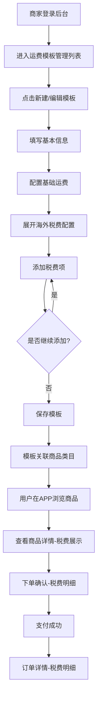

# 商家后台-升级运费模板支持海外税费 PRD v1.3

## 1. 项目信息与版本记录

- **产品名称**：商家后台-升级运费模板支持海外税费
- **版本**：v1.3
- **负责人**：林长宇
- **创建时间**：2026-04-23
- **更新时间**：2026-07-15

### 版本迭代记录

| 版本   | 日期         | 变更项                       | 负责人 |
| ---- | ---------- | ------------------------- | --- |
| v1.0 | 2026-04-23 | 初始版本创建，完成需求收集与PRD文档编写     | 林长宇 |
| v1.1 | 2026-05-06 | 明确需求范围，优化功能描述和标注，添加用户场景描述 | 林长宇 |
| v1.2 | 2026-07-09 | 修复续重计算浮点计算bug；商品详情页海外税费前缀自定义；订单确认页运费总价文案自定义 | 林长宇 |
| v1.3 | 2026-07-15 | 售后平台-退款管理优化，支持跨境服务费（原海外税费）展示和退款确认操作 | 林长宇 |

## 2. 需求背景与目标

### 2.1 现状问题与痛点

JYC项目涉及海外商品销售，目前运营团队希望在商家后台升级运费模板支持海外税费，以满足进口商品的不同运费计算需求。

现状痛点：

1. **税费无法独立计算**：目前海外税费直接加到商品价格里，无法单独管理和展示
2. **商家配置不灵活**：无法针对不同商品类目设置不同的海外税费规则
3. **用户看不到税费明细**：APP端用户无法清晰了解所支付的税费构成

### 2.2 需求提出的必要性

通过升级运费模板支持海外税费，可以实现税费与运费独立计算，支持按商品类目设置不同税费规则，APP端逐项展示税费明细。

### 2.3 业务目标

| 目标类型 | 描述         | 衡量指标      | 目标值  |
| ---- | ---------- | --------- | ---- |
| 功能扩展 | 支持海外税费独立配置 | 海外税费模板配置率 | ≥80% |
| 用户体验 | 提升价格透明度    | 税费明细展示完整率 | 100% |

## 3. 用户与使用场景

### 3.1 核心用户

- **商家后台用户（仅限小芒自营）**：设置和管理运费模板，配置海外税费规则

### 3.2 典型场景

1. 商家进入运费模板管理列表，查看现有模板
2. 商家编辑运费模板，展开高级配置添加海外税费项
3. 商家为每项税费设置名称、计费方式、首件/续件费用
4. 用户在APP商品详情页查看税费明细
5. 用户在下单确认页核对税费总额
6. 用户在订单详情页查看税费构成

### 3.3 核心用户旅程

| 阶段 | 用户触点     | 用户行为           | 痛点/情绪       | 产品机会        |
| -- | -------- | -------------- | ----------- | ----------- |
| 配置 | 运费模板编辑页  | 展开高级配置，添加海外税费项 | 困惑：税费如何设置？  | 提供清晰的配置引导   |
| 下单 | APP商品详情页 | 查看运费和税费明细      | 疑虑：税费怎么这么高？ | 清晰展示税费构成    |
| 支付 | 下单确认页    | 核对总费用包含税费      | 不解：税费包含哪些？  | 分项展示运费和各项税费 |

## 4. 需求功能清单

### 4.1 商家后台端功能

| 功能模块   | 功能点                         | 优先级 | 功能标识                            |
| ------ | --------------------------- | --- | ------------------------------- |
| 运费模板管理 | 展示运费模板列表，支持查看编辑             | P0  | admin\_shipping\_template\_list |
| 运费模板编辑 | 新增/编辑模板基本信息，在原有配置基础上添加海外税费项 | P0  | admin\_shipping\_template\_edit |
| 售后平台-退款管理 | 支持跨境服务费（原海外税费）展示和退款确认操作 | P0  | admin\_refund\_management |

### 4.2 APP端功能

| 功能模块  | 功能点       | 优先级 | 功能标识                 |
| ----- | --------- | --- | -------------------- |
| 商品详情页 | 展示运费和税费明细 | P0  | app\_product\_detail |
| 下单确认页 | 展示运费和税费明细 | P0  | app\_checkout        |
| 订单详情页 | 展示运费和税费明细 | P0  | app\_order\_detail   |

### 4.3 商家APP端功能

| 功能模块  | 功能点       | 优先级 | 功能标识                 |
| ----- | --------- | --- | -------------------- |
| 运费模板管理 | 限制编辑 | P0  | mapp\_shipping\_template |

### 4.4 本期功能清单

| 功能模块  | 功能点       | 优先级 | 功能标识                 |
| ----- | --------- | --- | -------------------- |
| 售后平台-退款管理 | 支持跨境服务费（原海外税费）展示和退款确认操作 | P0  | admin\_refund\_management |

## 5. 详细方案

### 5.1 商家后台端

#### 5.1.1 运费模板管理（admin\_shipping\_template\_list）

**功能描述**：展示运费模板列表，支持商家新建模板、编辑现有模板。

**页面结构**：

| 区域    | 内容          |
| ----- | ----------- |
| 操作区   | 新建模板按钮      |
| 搜索筛选区 | 模板名称搜索、筛选按钮 |
| 数据表格区 | 模板列表展示      |

**数据表格字段**：

| 字段     | 说明         |
| ------ | ---------- |
| 模板名称   | 运费模板的名称    |
| 计费方式   | 按件 / 按重量   |
| 是否独立计费 | 是 / 否      |
| 海外税费   | 已配置 / 未配置  |
| 关联类目   | 关联的商品类目数量  |
| 状态     | 启用 / 禁用    |
| 操作     | 编辑 / 禁用或启用 |

#### 5.1.2 运费模板编辑（admin\_shipping\_template\_edit）

**功能描述**：新建或编辑运费模板，配置基础运费和海外税费。

**编辑面板（右侧滑出，宽度90%）**：

**基本信息区块**：

| 字段     | 类型          | 说明                           |
| ------ | ----------- | ---------------------------- |
| 模板名称   | 输入框         | 模板名称                         |
| 是否独立计费 | Toggle 切换开关 | 是 / 否 ,额外描述：相同运费模板的商品，是否独立计费 |

**基础运费配置区块**：

| 字段         | 类型   | 说明         |
| ---------- | ---- | ---------- |
| 计费方式       | 下拉选择 | 按件 / 按重量   |
| 首件/首重数量    | 数字输入 | 首件/首重的起始数量 |
| 首件/首重费用（元） | 数字输入 | 首件/首重的费用金额 |
| 续件/续重数量    | 数字输入 | 每续一批次的数量   |
| 续件/续重费用（元） | 数字输入 | 每续一批次的费用金额 |

**海外税费配置（高级）区块**：

| 字段      | 类型   | 说明           |
| ------- | ---- | ------------ |
| 添加税费项按钮 | 按钮   | 添加海外税费项目新增表单 |
| 税费项列表   | 展示列表 | 列表           |

**每项税费项配置**：

| 字段         | 类型   | 说明                          |
| ---------- | ---- | --------------------------- |
| 税费名称       | 输入框  | 右侧提供两项常用值快捷设置按钮：海外运费、关税与清关费 |
| 计费方式       | 按钮选择 | 按件 / 按重量                    |
| 首件/首重数量    | 数字输入 | 首件/首重的起始数量                  |
| 首件/首重费用（元） | 数字输入 | 首件/首重的费用金额                  |
| 续件/续重数量    | 数字输入 | 每续一批次的数量                    |
| 续件/续重费用（元） | 数字输入 | 每续一批次的费用金额                  |

**税费项配置和计算规则**：

- 仅小芒自营店用户可配置海外税费项
- 同一模板内最多配置5项税费项
- 同一模板内不允许重复添加相同名称的税费项
- 海外税费计算均按模板独立计算，国内运费配置项互不影响

**续重计算精度优化**：

- 修复续重计算基础单位为小数时的浮点精度问题，确保费用计算准确
- 修复海外税费计算精度问题
- 计算逻辑由研发负责优化，确保计算精度和效率
- 限制国内运费续重规则配置仅到0.1精度

#### 5.1.3 售后平台-退款管理（admin_refund_management）

**功能描述**：支持跨境服务费（原海外税费）在退款管理中的展示和退款确认操作，商家可选择不同的退款选项。

**页面结构**：

| 区域    | 内容          |
| ----- | ----------- |
| 操作区   | 搜索、筛选按钮    |
| 数据表格区 | 退款订单列表展示    |
| 操作列   | 同意退款、拒绝按钮  |

**数据表格字段**：

| 字段     | 说明         |
| ------ | ---------- |
| 售后单号   | 售后订单编号    |
| 订单号    | 关联订单编号    |
| 订单状态    | 关联订单状态，待发货/已发货    |
| 商品    | 商品名称        |
| 退款原因   | 用户退款原因      |
| 订单金额   | 订单总金额      |
| 运费    | 订单运费，包含国内运费和跨境服务费（原海外税费），有跨境服务费时，两行加子标签展示       |
| 申请时间   | 用户申请退款时间    |
| 状态     | 待处理/处理中等    |
| 操作     | 同意退款、拒绝    |

**同意退款弹窗**：

| 字段     | 类型   | 说明         |
| ------ | ---- | ---------- |
| 订单商品结算金额 | 展示   | 商品货款金额     |
| 订单状态    | 关联订单状态，待发货/已发货    |
| 用户申请的退款比例 | 展示   | 申请退款的比例    |
| 是否整单退款 | 展示 ｜ 整单退款 / 仅部分商品退款    |
| 订单运费   | 展示   | 包含国内运费和跨境服务费（原海外税费），有跨境服务费时，两行加子标签展示     |
| 跨境停售时间 | 展示 ｜ 跨境停售时间，仅命中“跨境服务费售后”类型标签时展示，否则不展示  |
| 处理备注   | 输入框  | 处理退款的备注说明   |

**跨境服务费退款选项**：

| 序号 ｜ 选项 | 说明                |
| --- | --- --- | ----------------- |
| 1 | 商品货款    | 展示金额，选中，只读 |
| 2 | 国内运费        | 展示金额，可选   |
| 3 | 跨境服务费   | 展示金额，可选   |

**退款规则**：

- 当订单包含跨境服务费时，展示跨境服务费退款选项，不选中国内运费和跨境服务费
- 商品产品标签分类“跨境服务费售后”配置
  - KV键：MGECOM_OVERSEAS_SHIP_REFUND_RETURN_FORBIDDEN_GOODS_LABEL_CATEGORY
  - 此分类标签的描述字段改为日期格式，用作停售时间日期，由业务确保配置正确，格式为YYYY-MM-DD，例如：2026-04-23 表示2026年4月23日0时0分0秒停售
- 跨境服务费退款规则备忘
  - 商品标签在“跨境服务费售后”停售时间后，退款规则如下
    - 订单状态为待发货时，建议退款“商品货款+国内运费”
    - 订单状态为已发货/其他状态时，建议退款“商品货款”
  - 商品标签未命中“跨境服务费不可退”或在“跨境服务费售后”停售时间前时，退款规则同原有普通商品逻辑，运费包括国内运费+跨境服务费
    - 订单状态为待发货时，建议退款“商品货款+国内运费+跨境服务费”
    - 订单状态为已发货/其他状态时，建议退款“商品货款”
- 当订单不包含跨境服务费时（已有逻辑）
  - 订单状态为待发货时，列示运费金额，并直接按“商品货款+运费”计算退款金额
  - 订单状态为已发货/其他状态时，不列示运费金额，并直接按“商品货款”计算退款金额

### 5.2 APP端

#### 5.2.1 商品详情页（app\_product\_detail）

**功能描述**：展示商品详情，包含配送信息和海外税费明细。

**页面内容**：

| 内容模块 | 说明                                    |
| ---- | ------------------------------------- |
| 商品信息 | 商品图片、名称、价格                            |
| 配送信息 | 在 运费 行基础上增加海外税费合计项 |
| 配送信息 | 支持KV配置 海外税费商品详情页合计文案前缀 （MGECOM_OVERSEAS_SHIP_INFO_PREFIX），默认值：其他费用 |

#### 5.2.2 下单确认页（app\_checkout）

**功能描述**：展示订单确认信息，包含商品、运费和海外税费明细。

**页面内容**：

| 内容模块 | 说明                |
| ---- | ----------------- |
| 收货地址 | 收货人、联系电话、收货地址     |
| 商品信息 | 商品图片、名称、单价、数量     |
| 配送信息 | 在 运费 行基础上增加海外税费行  |
| 费用汇总 | 商品金额+运费+海外税费=实付金额 |
| 费用汇总 | 有海外税费项目时，支持KV配置运费总价文案自定义（MGECOM_OVERSEAS_SHIP_TOTAL_PREFIX），默认值：运费总价 |

#### 5.2.3 订单详情页（app\_order\_detail）

**功能描述**：展示已完成订单的详细信息，包含税费明细。

**页面内容**：

| 内容模块   | 说明                       |
| ------ | ------------------------ |
| 订单状态   | 当前订单状态（待支付/已支付/运输中/已完成等） |
| 物流信息   | 运单号、物流进度                 |
| 收货地址   | 收货人、联系电话、收货地址            |
| 商品信息   | 商品图片、名称、单价、数量            |
| 配送信息   | 在 运费 行基础上增加海外税费行         |
| 订单费用明细 | 商品金额、运费、海外税费合计、实付金额      |
| 下单时间   | 订单创建时间                   |

### 5.3 商家APP端

#### 5.3.1 运费模板管理（mapp\_shipping\_template）

**功能描述**：编辑运费模板数据时，overseas_fee_items数组不为空时，禁止保存，提示“此模板包含海外税费，请在Web后台编辑”

## 6. 业务流程图

## 7. 异常与边界处理

### 无

## 8. 数据埋点和上报

无

## 9. 未来演进规划

无

## 10. 附件

无

##
